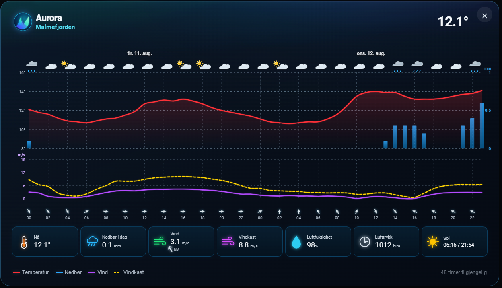
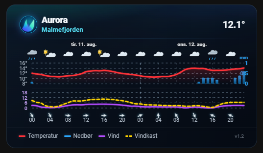
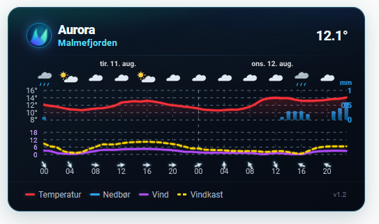
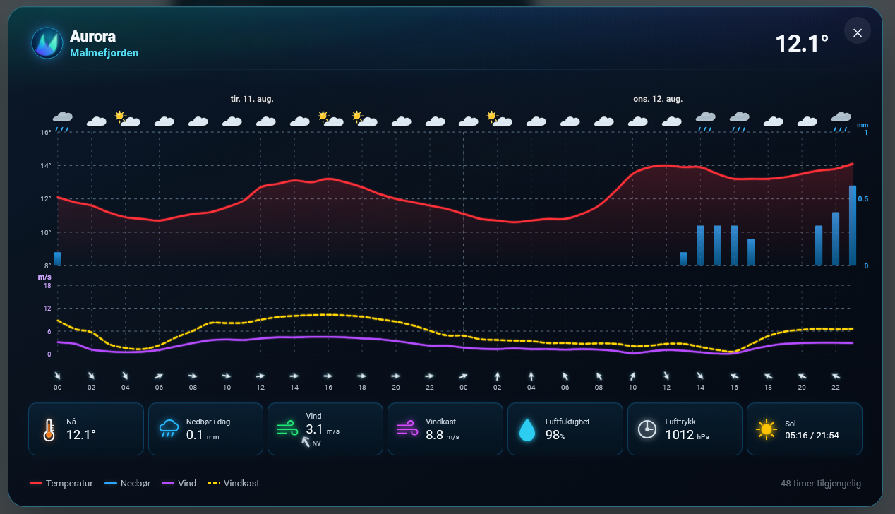
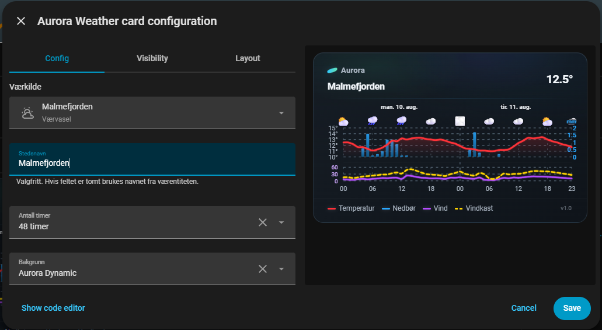

# Aurora Weather Card

A premium weather card for Home Assistant.

Aurora Weather Card combines modern weather visualization with a calm Scandinavian-inspired design.

> **Information first. Atmosphere second.**

## Screenshots

### Expanded 48-hour view



### Compact view



### Light mode





## Features

- Temperature forecast graph
- Precipitation graph with dynamic scale
- Wind and wind-gust graphs
- Wind direction indicators
- Wind values displayed in m/s
- Hourly weather icons
- 24 / 48 hour forecast
- Responsive desktop, tablet and mobile layout
- Expandable detailed 48-hour view
- Weather information tiles in expanded view
- Visual configuration editor
- Six independent GRAPH switches, with matching legend visibility
- Place-name search, local time-zone selection and manual location fallback
- Aurora Static
- Aurora Dynamic Atmosphere
- Day atmosphere
- Animated Northern Lights night atmosphere
- Seasonal atmosphere support

## Weather data

By default, Aurora Weather Card uses a Home Assistant `weather.*` entity. An optional **Direct — Open-Meteo** source fetches weather for the selected coordinates without a weather entity.

MET Norway / Met.no is recommended, but another compatible Home Assistant weather entity can be used.

## Installation

### HACS

Install **Aurora Weather Card** through HACS.

The card uses:

`aurora-weather-card.js`

After installation, reload Home Assistant if necessary.

### Manual installation

Copy:

`dist/aurora-weather-card.js`

to:

`/config/www/aurora-weather-card/aurora-weather-card.js`

Add the Lovelace resource:

`/local/aurora-weather-card/aurora-weather-card.js`

Resource type:

`JavaScript module`

Reload the browser resources or restart Home Assistant if necessary.

## Example

```yaml
type: custom:aurora-weather-card
entity: weather.home
location_name: Home
hours: 48
theme: aurora_dynamic
```

## Configuration

| Option | Description |
| --- | --- |
| `weather_source` | `entity` (default) or `open_meteo` |
| `entity` | Home Assistant `weather.*` entity; required in entity mode |
| `color_mode` | `auto` (default), `light`, or `dark`; applies to both views |
| `location_name` | Custom location name shown in the card |
| `hours` | Forecast period, 24 or 48 hours |
| `theme` | Aurora theme/background selection |
| `show_temperature` | Show temperature graph and legend; default `true` |
| `show_precipitation` | Show precipitation bars and legend; default `true` |
| `show_wind` | Show wind graph and legend; default `true` |
| `show_wind_gust` | Show wind-gust graph and legend; default `true` |
| `show_wind_direction` | Show wind-direction arrows; default `true` |
| `show_weather_icons` | Show forecast weather icons; default `true` |
| `latitude`, `longitude` | Required forecast coordinates in direct mode; optional solar-location fallback in entity mode |
| `time_zone` | Optional IANA time zone, for example `Europe/Oslo` |

The GRAPH options apply to compact and expanded views. Existing configurations keep all graph elements enabled.

CONFIG can search for a place name through Open-Meteo geocoding and save the selected coordinates and time zone. ADVANCED provides manual fallback fields. In entity mode, changing the display location does not relocate that entity's forecast. In direct mode, the selected coordinates determine the forecast.

### Upgrading to v1.4.1

Update through HACS and reload your browser. Existing dashboards keep `type: custom:aurora-weather-card`.

For manual installations, replace the resource file and append `?v=1.4.1` to its URL. Development-build users should change `custom:aurora-weather-card-dev` to `custom:aurora-weather-card` when switching to the stable resource.

## Visual editor

Aurora Weather Card includes a visual configuration editor for Home Assistant.



## What's new in v1.4.1

- Automatic, light and dark color modes for compact and expanded views.
- Optional direct Open-Meteo forecasts; the Home Assistant entity remains the default.
- Hidden/missing gusts no longer leave a legend entry; axes and plot allocation follow graph choices.
- Forecast receipt time in both views and clearer location-search guidance.
- Card/editor translations for English, Norwegian Bokmål and German. Other languages use English for Aurora-specific text; weather labels use Home Assistant translations where available.
- The existing Aurora night atmosphere is retained.

### Direct forecasts

Choose **Direct — Open-Meteo** under Settings → Weather source type, then search and select a place (or enter coordinates under Advanced).

```yaml
type: custom:aurora-weather-card
weather_source: open_meteo
location_name: Berlin
latitude: 52.52
longitude: 13.41
time_zone: Europe/Berlin
hours: 48
color_mode: auto
```

The browser sends selected coordinates to Open-Meteo, without Home Assistant credentials. The free API is for non-commercial use, including personal home automation: [terms](https://open-meteo.com/en/terms). Direct forecasts use °C, mm and m/s. Attribution is displayed in both views.

While the card is open, requests refresh every 30 minutes with a shared in-memory cache per page. Other browsers/devices have separate caches. Failed requests retry after 5 minutes; retained data is labelled with its original receipt time and an error message. “Forecast received” means when the card obtained the data, not when the provider issued it.

Existing configurations keep their weather entity. The new automatic color mode follows Home Assistant; select **Dark** to retain an always-dark card. The isolated test card is separate: use `custom:aurora-weather-card` with the stable HACS resource for production.

## Previous update: v1.2

Version 1.2 brings the completed Aurora Dynamic Atmosphere together with a refined compact and expanded weather experience.

- Refined compact card layout
- Expanded 48-hour forecast
- Improved graph spacing and scales
- Dynamic precipitation scaling
- Wind direction indicators
- Expanded-view weather information tiles
- Code-based SVG metric icons
- Aurora Dynamic Atmosphere
- Animated Northern Lights night mode
- Day atmosphere
- Seasonal atmosphere support
- Responsive refinements for desktop, tablet and mobile

## Compatibility

Designed and tested with:

- Home Assistant 2026.8+
- Sections Dashboard
- Masonry Dashboard
- Light Theme
- Dark Theme
- Desktop
- Tablet
- Mobile

## Design Philosophy

Aurora Weather Card was created around one simple idea:

> **Information first. Atmosphere second.**

The weather should always be easy to read.

Visual effects should support the information, never compete with it.

## Credits

Created by **Arne Aleksandersen**.

Designed and developed in collaboration with OpenAI ChatGPT through extensive real-world testing in Home Assistant.

## License

MIT License
